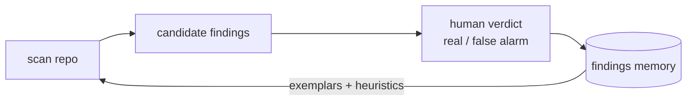

# Snitch

Oct 1, 2026 · @MXDUB

Snitch is a terminal coding agent in TypeScript that also audits open-source Rust code for security vulnerabilities — it maps a repo, finds vulnerability candidates, reasons about each one, and emits a disclosure-ready advisory, getting sharper with every scan. Lightweight by design, built in documented phases, and structured so the model, tools, and UI evolve independently.

## Objectives

Snitch does two things on the same engine: it is a working terminal coding agent, and it is a self-improving security auditor for Rust. The concrete goals:

1. **Be a usable coding agent** — plan a task, call tools in a loop (read/edit files, search, run commands), and report back, with a human approval gate on anything that mutates the machine.
2. **Audit Rust repos for SSRF** — take an open-source Rust codebase and find server-side request forgery vulnerabilities in it, with a proof-of-concept for each.
3. **Keep false positives low** — use a deterministic pre-filter plus sliced LLM reasoning so findings are trustworthy, not noise.
4. **Improve itself over time** — learn from each human verdict so later scans rank better and flag fewer false alarms.
5. **Produce disclosure-ready output** — emit a clean advisory (root cause, source→sink, PoC, fix) for every confirmed finding.
6. **Run on either a Claude subscription or any BYOK provider** — no lock-in to one model or billing path.
7. **Stay lightweight and modular** — few dependencies; model, tools, and UI each swappable.

Non-goals (for now): attacking live systems, bug classes beyond SSRF, and multi-user hosting. Snitch reasons about code and proposes; a human confirms before anything is treated as real.

## The coding agent

The foundation everything else builds on.

- **Agent loop** — model → tool calls → results → model, until the task is done. Guards: iteration cap, context-budget trimming, Esc/Ctrl+C cancellation, and graceful handling of denials, malformed arguments, and tool failures (all fed back to the model, never crashing the session).
- **10 tools** — `read_file`, `write_file`*, `edit_file`*, `list_dir`, `glob`, `grep`, `run_command`*, `todo_write`, `fetch_url`, `task`*. Starred tools show a y/n approval card before executing. `task` spawns a one-level sub-agent with a fresh conversation whose tool calls run without further prompts.
- **Ink React TUI** — flicker-free transcript, live streaming output, approval cards, spinner + token/cost status bar, slash commands.
- **Headless mode** — the same loop scripted from the CLI (`--headless`), y/n prompts on stdin, `--yes` to auto-approve.
- **Provider abstraction** — one `LLMProvider` contract; raw `fetch` + SSE against an OpenAI-compatible API, retry/backoff for rate limits, and a `--prompt-tools` adapter so models without native tool calling drive the same loop via fenced-JSON calls.
- **Approval gate** — the single mechanism that keeps the agent safe, and the same one security mode reuses as its disclosure gate.

The loop is an async generator of `AgentEvent`s that knows nothing about rendering — the TUI, the headless runner, and the scan flow are all just consumers of that one stream.

## Security mode

Security mode is a five-stage pipeline, built on the tools above. The LLM is only one stage — deterministic analysis narrows the repo to real candidates first, so the model reasons over small slices instead of a whole codebase.

| Stage | What it does | Built on |
|---|---|---|
| 1. Map | Find routes, handlers, and where external input enters | `glob`, `grep`, `read_file` |
| 2. Find sinks | Locate outbound-request call sites | `grep`, `read_file` |
| 3. Trace | Reason: does input reach the sink unvalidated? | `task` sub-agent on the sliced source→sink path |
| 4. Rank | Score by directness, missing sanitizer, source name + memory | ranker + findings memory |
| 5. Report | Render a disclosure-ready advisory with a PoC sketch | `write_file` into `findings/` |

**SSRF knowledge** (what stages 1–2 look for):

- **Sinks** — outbound calls: `reqwest`, `hyper`, `ureq`, `isahc`/`surf`, raw `TcpStream::connect`.
- **Sources** — input into handlers: `Path`/`Query`/`Json`/`Form` extractors, headers, and body fields named like `url`, `webhook`, `callback_url`, `endpoint`, `avatar_url`; plus stored values fetched later (second-order).
- **Sanitizers** (downrank if present) — host allowlist, `is_private`/`is_loopback`/`is_link_local` checks on the resolved IP, scheme restriction with host validation.
- **High-value shapes** — no validation at all; redirect-follow bypass (validate once, follow 302 blindly); incomplete IP filter (misses `[::1]`, `0.0.0.0`, decimal/octal, DNS to metadata); DNS rebinding (note, not v1 blocker).

**Disclosure gate.** A candidate is never recorded as confirmed until a human verifies it against a local instance they run and approves it — the same y/n card the coding agent uses for mutations. Snitch reads and reasons about code; it does not attack anything.

Scope: v1 of security mode detects SSRF only, in Rust HTTP servers.

## Self-improving memory

Snitch keeps a memory of what it has gotten right and wrong, and that memory feeds back into every future scan.



- On each verdict, Snitch records the code shape (the source→sink pattern), the verdict, and why — which sanitizer made a false alarm safe, or what made a real one exploitable.
- Next run, those records become few-shot exemplars in the trace prompt and weights on the ranker: real-bug patterns rank higher, false-alarm shapes get downranked or filtered.
- Entries decay over time (a half-life) so stale patterns fade and recent confirmed signal dominates.

The effect compounds: the more you use it, the fewer false alarms it raises. Memory lives in a local, inspectable store (`.snitch/memory/`) — plain JSON you can read, edit, or reset. Nothing about your scans leaves your machine.

## Models & auth

Two ways to supply a model. Both sit behind the `LLMProvider` contract, so the agent loop doesn't care which is active.

### 1. Claude subscription (via the Agent SDK)

Run Snitch on an existing Claude Pro/Max plan — no API key, no per-token billing. This goes through the Claude Agent SDK, which bills against the subscription using the Claude Code OAuth session.

Setup:

```bash
claude setup-token           # opens a browser, returns a ~1-year OAuth token
export CLAUDE_CODE_OAUTH_TOKEN=...
```

Snitch's subscription provider calls the Agent SDK with tools disabled (`allowedTools: []`) and reads the final message — so it behaves like a plain model call, not a nested agent.

**Gotcha:** if `ANTHROPIC_API_KEY` is set in the environment, it silently overrides the OAuth token and bills API credits instead. Unset it when you want the subscription path.

**Scope:** the OAuth token is licensed for individual use. This path is for running Snitch yourself — not for shipping a multi-user service, and heavy automated use can hit plan rate limits.

### 2. BYOK (any provider)

Bring your own key for anything:

- **OpenRouter** — one key, hundreds of models; pick any `anthropic/claude-*`, `openai/*`, or open model via a model string. Simplest option.
- **Anthropic** — a direct console.anthropic.com key (Messages API).
- **OpenAI** — a direct OpenAI key.

Config (`.env`, `snitch.config.json`, or flags):

```bash
# subscription:
CLAUDE_CODE_OAUTH_TOKEN=...      # and make sure ANTHROPIC_API_KEY is NOT set

# or BYOK (one of):
SNITCH_API_KEY=...               # OpenRouter (default)
ANTHROPIC_API_KEY=...
OPENAI_API_KEY=...
```

**Key hygiene** — it's a security tool: keys are read only from env or config, never logged, and redacted from any trace or error output.

## Architecture

```
src/
├── index.tsx      # CLI entry: --headless, --model, --prompt-tools, scan
├── config.ts      # auth (subscription / API key), model, budgets (.env / snitch.config.json / flags)
├── llm/           # LLMProvider contract; OpenAI-compat + SSE; retry; prompt-tools adapter; subscription (Agent SDK) adapter
├── tools/         # tool contract + registry; fs / search / shell tools
├── agent/         # the loop (AgentEvent stream); history + trimming; system prompts
├── security/      # SSRF knowledge (sources/sinks/sanitizers); the scan pipeline; advisory template
├── memory/        # findings store; reinforce + decay; exemplar selection for prompts
├── ui/            # Ink components: App, Transcript, ToolCallCard, InputBox, StatusBar
└── headless.ts    # readline runner over the same AgentEvent stream
```

`security/` orchestrates the existing tools into the scan pipeline; `memory/` is a side-channel the ranker and trace prompt read from and write to. Both are additive — with neither invoked, Snitch is a plain coding agent.

## Usage

Coding agent:

```bash
snitch                                   # interactive TUI
snitch --headless "create hello.py and run it"
snitch --headless --yes "..."            # auto-approve (scripts/pipes)
snitch --headless --plan "..."           # plan mode: read-only tools, returns a plan
snitch --model <id>                      # override model for this run
snitch --prompt-tools                    # tool calling for models without native support
```

Security mode:

```bash
snitch scan <path-or-git-url>            # audit a Rust repo for SSRF
snitch scan <repo> --headless            # scriptable; advisories written to findings/
```

A scan maps the repo, surfaces ranked candidates, and writes a draft advisory per High-confidence finding into `findings/`, each marked UNVERIFIED until you confirm it against a local instance and approve it at the disclosure gate — only then is it recorded and fed into memory.

In the TUI: type a task and press Enter; mutating tool calls show an approval card (y/n); Esc cancels. `/scan <repo>` starts a scan and candidates stream in as cards you accept or reject. A `SNITCH.md` in the working directory is injected into the system prompt at startup. Slash commands: `/help`, `/clear`, `/plan`, `/compact`, `/model <id>`, `/exit`.

## Requirements & getting started

- Node.js ≥ 22
- A real terminal (Windows Terminal recommended on Windows; legacy conhost is flaky with raw input)
- A model backend — either a Claude Pro/Max subscription (`claude setup-token`) or an API key (`SNITCH_API_KEY` / `OPENROUTER_API_KEY` / `ANTHROPIC_API_KEY` / `OPENAI_API_KEY`)
- For scanning — the target Rust repo locally, and (to verify findings) the ability to run it locally; Docker recommended

```bash
npm install
npm run dev        # run the TUI from source
npm test           # run the test suite
npm run build      # compile to dist/
npm link           # make the `snitch` command available globally
```

## Scope & roadmap

**Now:** the coding agent, and security mode for SSRF in Rust — the scan pipeline, the self-improving findings memory, advisory output, the disclosure gate, and subscription + BYOK auth.

**Next:**

- **IDOR / broken access control** — highest-value next class; semantic, so it needs auth-context modeling.
- **Injection sinks** — `format!` into sqlx, command execution; cheap to add once the pipeline exists.
- **More sink coverage** — gRPC/tonic, template engines, path traversal.
- **Continuous / CI mode** — run on every push with a baseline so only new findings surface.
- **Polyglot** — the sources/sinks/sanitizers model generalizes; swapping the parser aims Snitch at Go or TypeScript.

Detailed, dated phases live separately from this README.

## Responsible use

Snitch reads and reasons about source code — it does not attack systems. Confirm any finding only against an instance you run yourself, and disclose through the project's security policy or a private GitHub Security Advisory. API keys and subscription tokens are read from the environment or config, never logged, and redacted from any output. See `SECURITY.md`.
